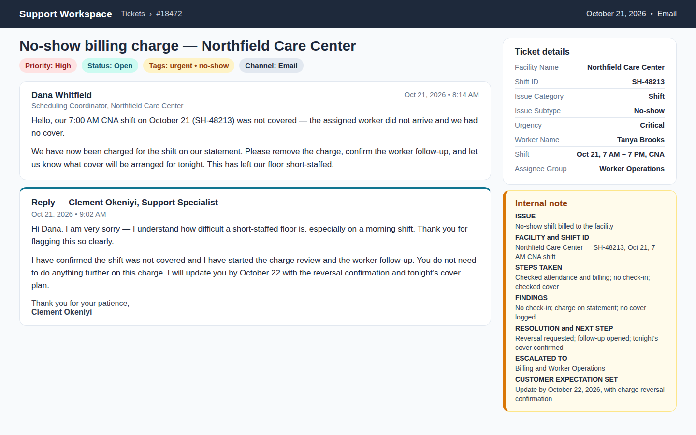
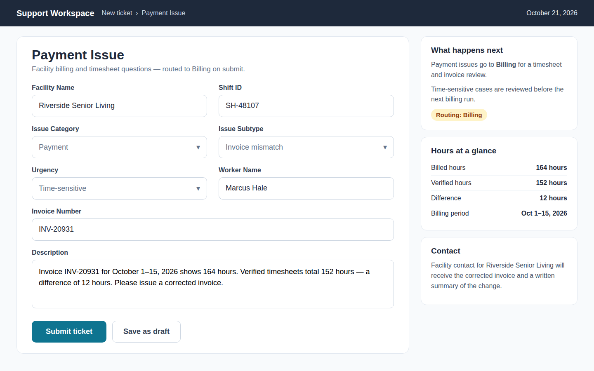
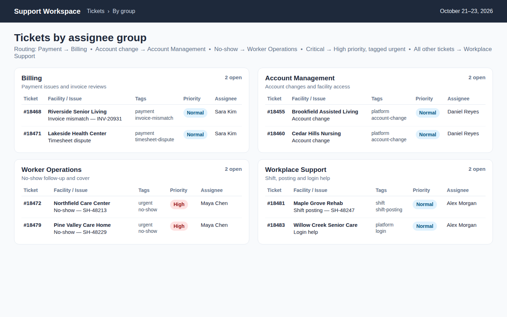
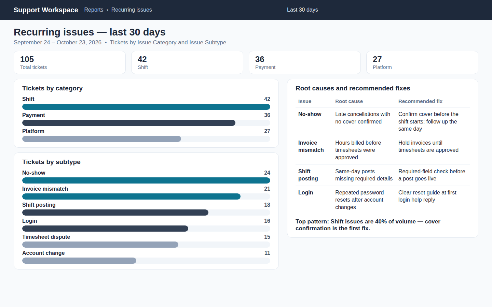
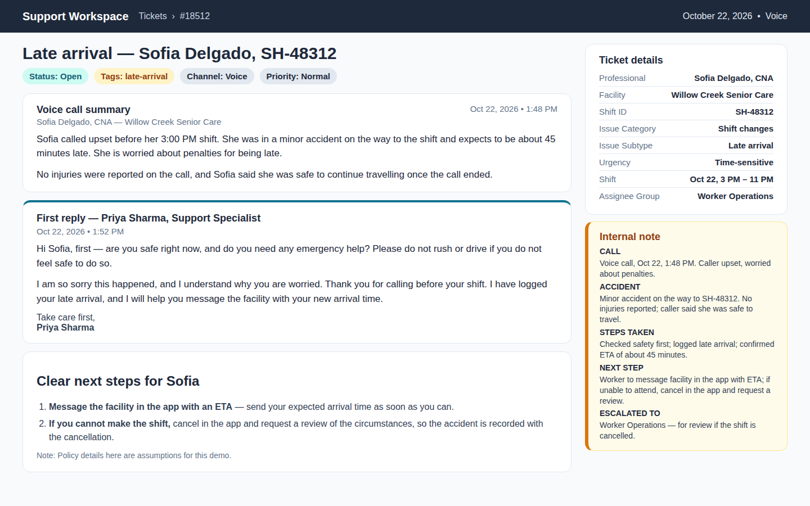
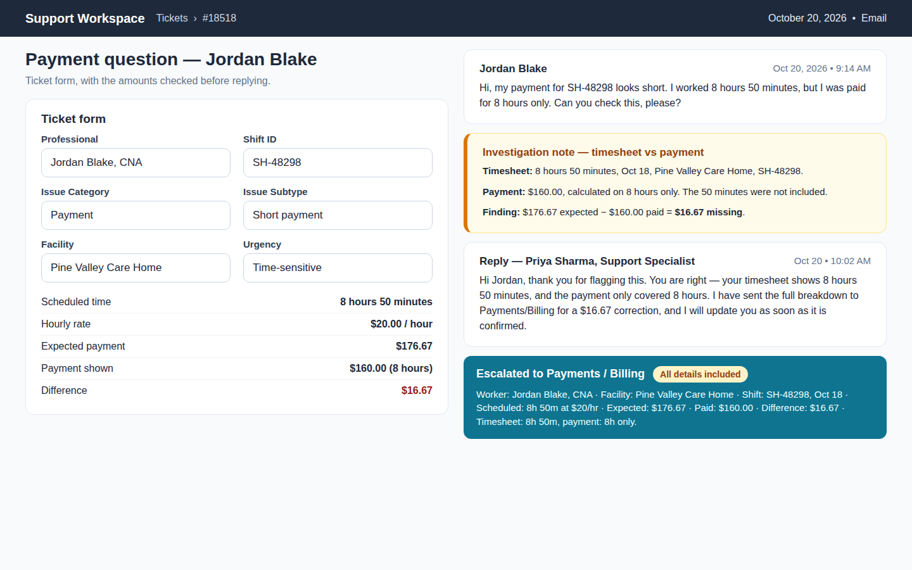
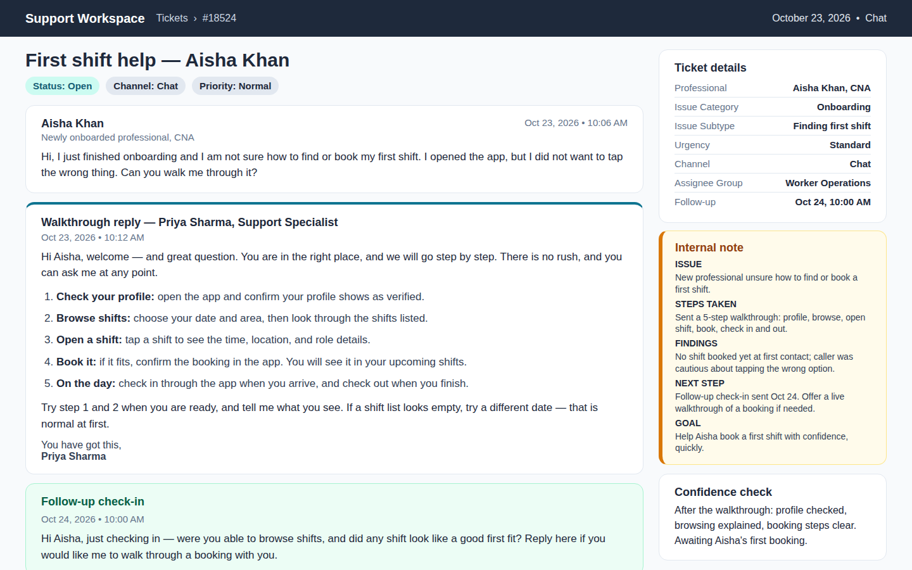
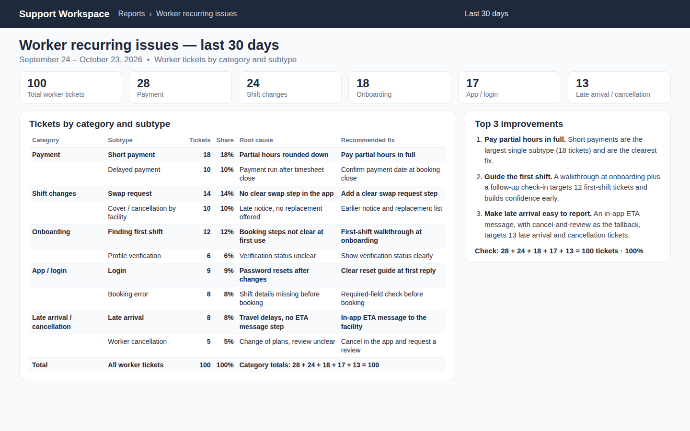

# Workplace and Worker Support — Healthcare Staffing

B2B support for healthcare facilities, and support for healthcare professionals: shift, payment, and platform issues, handled over voice, chat, and email.

## 1. Ticket thread — Northfield Care Center, SH-48213

No-show billing charge, empathetic reply, internal note, escalation to Billing and Worker Operations.

## 2. Ticket form — Riverside Senior Living, INV-20931

Payment Issue form, 164 hours billed vs 152 verified, routed to Billing.

## 3. Routing — Tickets by assignee group

Billing, Account Management, Worker Operations, and Workplace Support, with tags, priority, and assignee.

## 4. Recurring issues — Last 30 days

September 24–October 23, 2026: 105 tickets by category and subtype, with root causes and fixes.

## 5. Worker late arrival — Sofia Delgado, SH-48312

Voice call after a minor accident, safety-first reply, internal note, and clear next steps for the worker.

## 6. Worker payment question — Jordan Blake, SH-48298

8 hours 50 minutes at $20/hour: $176.67 expected, $160.00 paid, $16.67 missing, escalated to Payments / Billing.

## 7. New professional onboarding — Aisha Khan

Friendly step-by-step first-shift walkthrough, follow-up check-in, and internal note.

## 8. Worker recurring issues — Last 30 days

September 24–October 23, 2026: 100 worker tickets by category and subtype, with root causes, fixes, and top 3 improvements.

## Routing

Payment → Billing · Account change → Account Management · No-show → Worker Operations · Critical → High priority, tagged urgent · Everything else → Workplace Support.

## Worker routing

Payment question → Billing · Late arrival / cancellation → Worker Operations · Onboarding / first shift → Worker Operations · App / login → Workplace Support · Critical / safety → High priority, tagged urgent.

## Interactive pages

Open `index.html`, or any numbered page directly. Each page is sized for a 1440×900 view.

## Note

Recreated generic interface pages demonstrating field design, routing, documentation, and reporting for this kind of work. They are not live production records and not cases from a specific employer. All names, facilities, and IDs in the new worker pages are fictional, and policy details in the late-arrival page are assumptions for this demo.
